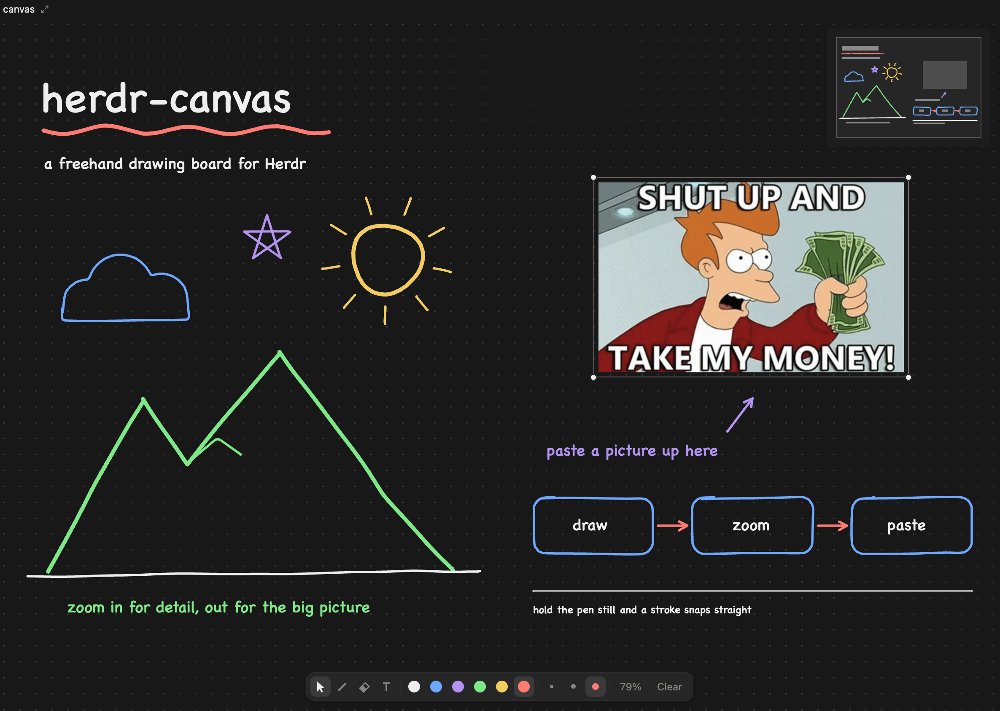

# herdr-canvas

A freehand drawing board for [Herdr](https://github.com/herdrdev/herdr-app). It opens as a pane in any tab. Every pane shows the same drawing.



## Features

- **Pen:** smoothed strokes that keep their shape. Draw fast to round out curves. Draw slowly for exact lines.
- **Straight lines:** hold the pen still at the end of a stroke for 200 ms. The stroke snaps to a straight line.
- **Eraser:** drag across strokes and text to remove them.
- **Pointer:** select, move, resize, copy, duplicate and delete items.
- **Text:** click to place text and type.
- **Images:** paste an image, or drop an image file on the canvas.
- **Pan and zoom:** scroll with two fingers, drag with the middle button, or hold Space and drag to pan. Pinch or Cmd-scroll to zoom from 10% to 800%.
- **Minimap:** shows the whole drawing and where the view is.
- **Undo and redo:** Cmd-Z and Cmd-Shift-Z.

Tool keys, pressed with no modifier:

| Key | Tool |
|---|---|
| S | Pointer |
| A | Pen |
| E | Eraser |
| T | Text |

Esc goes back to the pointer. The comment at the top of `mods/canvas/main.js` lists every shortcut.

## Install

The canvas needs macOS: it pastes images with `osascript` and converts dropped images with `sips`. It makes no network requests.

### With an agent

Give your Herdr agent this repo's URL and ask it to add the mod. Herdr's guide tells it how: it copies `mods/canvas/` into your mods folder and merges `keys.json` into yours.

### By hand

1. Clone this repo and copy the mod into your Herdr mods folder:

   ```sh
   git clone https://github.com/camerontredoux/herdr-canvas
   cp -R herdr-canvas/mods/canvas ~/.config/herdr-app/mods/canvas
   ```

2. Merge `keys.json` into `~/.config/herdr-app/keys.json`. Add its sections and keys. If you already use one of its keys, choose which binding to keep.

3. Check that Herdr can load the mod:

   ```sh
   herdr-app check mods/canvas
   ```

4. Press Cmd-Shift-E. The canvas opens in a pane to the right. Close the pane as you close any other.

## Keys

`keys.json` binds these keys:

| Key | Where | What it does |
|---|---|---|
| Cmd-Shift-E | Anywhere | Opens the canvas in a pane to the right |
| Cmd-D | Canvas | Duplicates the selection. With nothing selected, splits the pane as usual. |
| Cmd-Shift-Arrows | Canvas | Selects to the line start, line end, top or bottom while you type. Otherwise moves between panes as usual. |
| Alt-Shift-Left, Alt-Shift-Right | Canvas | Selects by word while you type. Otherwise switches tabs as usual. |

Outside a text box, Alt-Shift-Left and Alt-Shift-Right run Herdr's `tab.prev` and `tab.next`. Another mod can name its own commands in the shared value `canvas.tab-commands`, as `{ "prev": "...", "next": "..." }`.

## Where the drawing is saved

The canvas saves to Herdr's data folder on your computer. It does not save to this repository.

| File | Contents |
|---|---|
| `data/canvas/drawing.json` | Strokes, text and image references |
| `data/canvas/view.json` | Pan position, zoom, color and pen size |
| `data/canvas/images/` | Pasted and dropped images |

## Development

The mod lives in `mods/canvas/`.

- `main.js` is the view: tools, input, saving and painting.
- `geometry.js` holds the stroke geometry: smoothing, simplifying, straightening and tracing. It has no Herdr imports, so Node can test it.
- `text.js` moves the caret in a text box: by character, by word and by line. Like `geometry.js`, Node can test it.

Run the tests with Node:

```sh
node mods/canvas/test.mjs
```

Herdr writes `gpui-kit.d.ts` and `jsconfig.json` into the mod folder for editor type checking. `.gitignore` leaves them out.

If you edit the mod in your Herdr mods folder, `./sync.sh` copies it into this repo so you can commit it. Set `HERDR_HOME` if Herdr's folder is not `~/.config/herdr-app`.

`RECIPE.md` is the brief another agent can build the mod from. `preview.png` is the screenshot the Herdr gallery shows.

### Performance

Herdr stops a view's `render()` if it runs longer than about 50 ms, and then shows the last frame that worked. The canvas stays under that limit as follows:

- Strokes are drawn in 64 tile views. Herdr keeps a tile's drawing while the tile moves or stretches, so panning repaints no strokes.
- After a zoom, tiles rebuild at the new zoom, one tile per frame, nearest the middle of the screen first.
- Each frame has a time budget for building stroke paths. Work that does not fit waits for the next frame.
