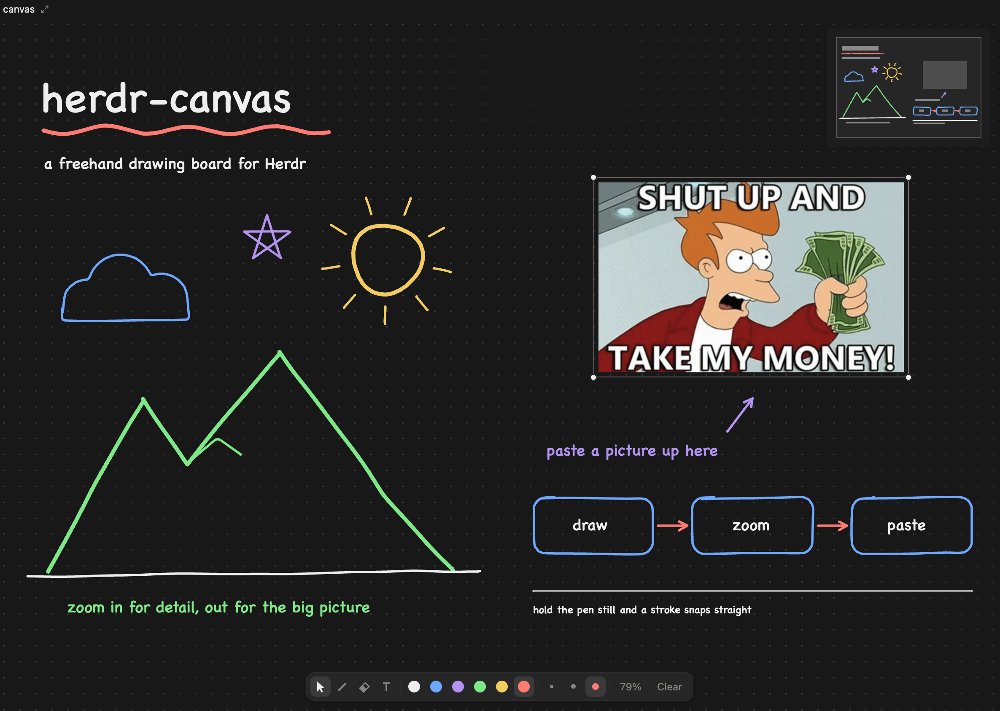

# Canvas

A freehand drawing board in a Herdr pane. You draw smooth pen strokes, type text, paste or drop images, and pan and zoom across one endless board. Every canvas pane, in any tab, shows the same drawing, and the drawing saves itself.

## What you see

The pane is one dark board with a faint dot grid. Three things float over it:

- **Toolbar:** a rounded bar centered at the bottom of the pane, 56 px tall. From left to right:
  - Four tool icons: pointer, pen, eraser and text. The active tool has a highlighted background.
  - Six color dots: the theme's foreground color, then `#6ea8fe` (blue), `#b392f0` (purple), `#7ee787` (green), `#f2cc60` (yellow) and `#ff7b72` (red). The active color has a ring.
  - Three size dots, small to large. They set the pen width (2, 3.5 or 6 px) and the text size (16, 24 or 36 px).
  - The zoom level as a percentage, for example `79%`.
  - A `Clear` button.
- **Minimap:** a panel 12 px in from the top-right corner. It is at most 200 × 140 px and at least 110 × 80 px, and it takes the shape of what it shows. It draws the whole drawing in small, with a rectangle for the part the pane shows.
- **Selection:** a thin outline 6 px out from the selected items, with a round handle at each corner.

Strokes have round ends and round joins. Text uses the Chalkboard SE font, with a line height of 1.3 times its size. Images keep their own colors.

## How it behaves

The canvas shows no agent status. It is a drawing board only.

**Tools.** Each tool has a key, pressed with no modifier. Esc, with nothing selected, goes back to the pointer from any other tool. The canvas opens with the pointer.

- **Pointer (S):**
  - Click an item to select it. Shift-click adds an item to the selection.
  - Drag on empty space to select everything in a rectangle.
  - Drag a selection to move it. Drag a corner handle to resize it.
  - Arrow keys move the selection 1 screen px, or 10 px with Shift. Backspace or Delete removes it.
  - A color or size you pick changes the selected items.
  - Double-click text to edit it. Double-click empty space to type new text there.
- **Pen (A):** drag with the left button to draw.
  - Fast strokes keep fewer points, and the tracing rounds them into smooth curves. Slow strokes stay exact.
  - The first 6 px after the pen lands keep no points, so the flick as the pen lands doesn't show.
  - Hold the pen still for 200 ms at the end of a roughly straight stroke, and the stroke snaps to a straight line.
- **Eraser (E):** drag across strokes and text. They dim while you drag and go when you let go. A ring shows where the eraser reaches (8 px around the pointer). Images stay. Delete an image with the pointer.
- **Text (T):** click to place text and type.
  - Arrows, Option-arrows (by word), Cmd-arrows and Home/End move the caret. Shift selects.
  - Enter starts a new line. Esc, or a click away, finishes the text and goes back to the pointer.

**Everywhere.**

- Cmd-A selects everything. In a text box, it selects all the text.
- Cmd-C, Cmd-X and Cmd-D copy, cut and duplicate the selection.
- Cmd-V pastes copied items under the pointer. With none copied, it pastes the clipboard's image, else its text.
- Drop an image file on the canvas to add it.
- Cmd-Z undoes and Cmd-Shift-Z redoes.

**Pan and zoom.**

- Scroll with two fingers to pan. Dragging with the middle button, or holding Space and dragging, also pans. While Space is down, the cursor is a grab hand and a drag pans with any tool.
- Pinch, or Cmd-scroll, to zoom from 10% to 800% around the pointer.
- Click or drag on the minimap to move the view there.
- Click the zoom percentage to bring the whole drawing back into view. It centers the drawing at 100%, or zooms out until the drawing fits above the toolbar.

**Clear** removes everything at once. Cmd-Z brings it back.

**Keys taken back from Herdr.** `keys.json` binds some keys in a `mod:canvas` section, so the canvas gets them even though Herdr binds them globally. The canvas uses each key only when it has a use for it. Otherwise it does what the key does in Herdr:

| Key | In the canvas | Otherwise |
|---|---|---|
| Cmd-D | Duplicates the selection | `pane.split` to the right |
| Cmd-Shift-Arrows | Selects to the line start, line end, top or bottom while you type | `pane.go` that way |
| Alt-Shift-Left, Alt-Shift-Right | Selects by word while you type | `tab.prev`, `tab.next` |

For Alt-Shift-Left and Alt-Shift-Right, another mod can name its own commands in the shared value `canvas.tab-commands`, as `{ "prev": "...", "next": "..." }`.

**Saving.** Every copy shares one drawing. Changes save 600 ms after the last one.

- `data/canvas/drawing.json` holds the strokes, text and image references.
- `data/canvas/view.json` holds the pan position, zoom, color and size, so panning doesn't rewrite the drawing.
- `data/canvas/images/` holds pasted and dropped images, named by a hash of their contents. Images the drawing no longer uses are deleted when the canvas loads.

## Built from

**Files.** `mods/canvas/` has these files:

- `mod.json`: `{ "place": "none", "title": "Canvas", "focusable": true }`.
- `main.js`: the views, input, saving and painting.
- `geometry.js`: stroke geometry with no Herdr imports, so Node can test it.
- `text.js`: caret movement in a text box, also with no Herdr imports.
- `test.mjs`: Node tests for `geometry.js` and `text.js`.

**Opening.** The canvas has no layout of its own. `keys.json` opens it with `pane.split` and the args `{ "direction": "right", "mod": "canvas" }`. `herdr-app do tab.new --mod canvas` opens it in a new tab.

**Views.** `main.js` exports one `View`, the canvas. It makes these child views with `cx.new`:

- **64 tile views,** which hold the strokes. Each tile owns a run of places in the stacking order, at least 64 places. The run doubles as the drawing grows.
- **Ink:** the stroke you are drawing, so each pen move repaints only that stroke.
- **Eraser ring:** follows the pointer without repainting the canvas.

**The drawing.** The drawing is module state, so every copy of the view shares it.

- Items never change once made. A move, an edit or a recolor replaces items with new ones, which keep their place in the stacking order (`ord`).
- Each undo step is the items it added and the items it removed.
- A stroke is a color, a width and a flat array of points. A stroke with two points and `a` set is an arrow. There is no arrow tool now, but arrows saved by an older version still load, draw and edit.

**Stroke pipeline.** A stroke goes through these steps in `geometry.js`:

1. `stream`: each new point moves 45% of the way from the last kept point toward the pen.
2. `smooth`: Taubin smoothing (a pass that smooths, then a pass of −10/9 that un-shrinks), over 4 points on each side.
3. `simplify`: drops points that add no visible shape.
4. `straight` and `level`: snap a held stroke to a straight line.
5. `trace`: draws the points as curves. A curve tighter than half the line width becomes a corner, or a dot, because a round join looks right there and a curve would draw a spike.

A stroke keeps a point at most every 16 ms while you draw.

**Painting.** Painting uses `PathBuilder.stroke`, with path coordinates given as percentages of the painted box. That way a built path stretches when its box changes size.

- Strokes are grouped into chunks: runs of one color and width within 16 places in the stacking order, with at most 800 points.
- Each chunk's built paths are cached per zoom. A built path starts a new native path every 150 calls, because Herdr's path builder slows down sharply on long paths.
- Panning only moves tiles. Herdr keeps a tile's last frame while the tile moves or stretches, so panning repaints no strokes.
- While you zoom, tiles stretch their old build. Builds within a quarter of a doubling of the new zoom are reused. After 120 ms without a zoom step, tiles rebuild at the exact zoom, nearest the middle of the screen first, one tile per frame, 8 ms apart.
- Half a second after the view stops moving, every tile on screen draws once more. This replaces a frame that Herdr interrupted.

**`herdr` functions used:** `theme`, `appHome`, `checking`, `exec`, `nextCommand`, `run`, `shared`, `writeTextFile`, and `fs` for files under Herdr's folder.

**Commands it runs:** `pane.split`, `pane.go`, and `tab.prev`/`tab.next` (or the commands in `canvas.tab-commands`).

**Programs it runs:**

- `osascript`: reads an image from the clipboard on paste.
- `sips`: converts a dropped image that is not a PNG.
- `mv`: replaces a saved file in one step.

It makes no network requests. It reads files outside its own folder only when you drop one on the canvas.

## Watch out

- **Herdr's 50 ms render limit.** Herdr stops a `render()` that runs longer than about 50 ms and keeps showing the last frame that worked, with a red "could not be re-rendered" banner. Every frame that builds paths has a time budget: 15 ms for the main view, 12 ms for a tile. Work that doesn't fit waits for the next frame, which the view asks for 16 ms later. Without these budgets, zooming out over a dense drawing, or one long stroke, crosses the limit.
- **An interrupted frame can stick.** A tile can record that it is drawn at a zoom when Herdr never showed that frame. The tile then shows strokes built at another zoom: hollow rings for round ends, and lines too thick or too thin. The redraw half a second after the view stops fixes this.
- **Filled shapes cut holes where they overlap.** Herdr fills with the even-odd rule, so a filled outline that crosses itself shows holes. This is why strokes are lines, not filled outlines in the perfect-freehand style.
- **`cx.notify()` repaints the whole canvas.** Anything that changes on every pointer move, like the stroke you are drawing or the eraser ring, needs its own view.
- **Reloads.** When Herdr reloads the mod, the new build waits up to 1.5 s for the old build to save before it reads the file. It never saves a file it has not read, so a reload can't overwrite newer work.
- **During `herdr-app check`,** the canvas starts no timers, runs no programs, and never reads or writes the drawing. A check has a time limit, and it must never empty the live canvas.
- **macOS only.** Pasting and dropping images need `osascript` and `sips`.
- **No pressure and no taper.** Every point of a stroke has the same width.
